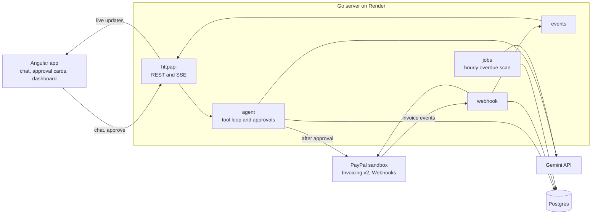

# PaidUp

Freelancers lose hours to invoices: typing the same client details again, working out totals, and chasing late payers. PaidUp is a chat assistant that does that work in PayPal for you. Describe a job in one line or send a photo of a quote, and Gemini drafts the PayPal invoice. **PaidUp sends nothing until you approve it.**

PaidUp is an entry for the PayPal AI Hackathon 2026. It runs against the PayPal sandbox only, so no real money moves. The link to the hosted demo and the test login are on the Devpost page.

## What it does

You write "Bill Jane at jane@example.com 450 USD for a landing page, due in 7 days." PaidUp answers with an invoice card: the client, the line items, the total, and the due date. Approve it, and the server creates the invoice in PayPal, sends it, and puts the payer link on the card. Reject it, and nothing reaches PayPal.

From there, PaidUp keeps watch:

- **Photos of quotes.** Attach a photo of a handwritten quote, a receipt, or a sticky note. Gemini reads the client, the items, and the prices into the same invoice card.
- **Live payment status.** When the client pays, PayPal sends a webhook. The dashboard changes the invoice to PAID as soon as the webhook arrives, with no reload.
- **Overdue reminders.** Every hour, the server looks for overdue invoices. For each one, Gemini writes a short, polite reminder, and PaidUp shows it as a card for you to approve.
- **Questions about money.** Ask "Who owes me money?" or "What did I get paid last month?" The answer comes from your PayPal invoices, not from the model's memory.
- **Reminders and cancels on request.** "Remind Jane about her invoice" or "Cancel the invoice to Jane" gives you a card too. Nothing changes in PayPal until you approve it.

## Why the approval step matters

An AI model that can send invoices can also send the wrong invoice to the wrong person. PaidUp keeps the model on the proposing side. The model can read invoices freely, but each write tool only creates a pending card. The server checks every proposal against fixed rules before it shows the card:

- the currency is one of USD, EUR, GBP, CAD, or AUD;
- the total is more than 0 and no more than 10,000.00;
- the due date is 1 to 90 days away.

Only a click on "Approve" starts a PayPal write call. The approval is an atomic state change in Postgres, so two clicks, or two browser tabs, cannot send the same invoice twice. Each PayPal write also carries a `PayPal-Request-Id`, so a retry after a network error does not create a duplicate.

## Architecture



One Go binary serves both the API and the built Angular app, so the demo has one URL. PayPal is the source of truth for invoices. Postgres keeps a cache, so the dashboard loads without a PayPal call, and webhooks keep that cache current. If a webhook is late, the "Refresh" button on each row asks PayPal directly.

Replies stream to the browser as Server-Sent Events. The chat and the approval calls are `POST` requests, so the Angular app reads the stream with `fetch` instead of `EventSource`.

## AI tools and how PaidUp uses them

**Google Gemini API (in the product).** PaidUp calls the REST `generateContent` endpoint in three places:

1. **The chat agent.** Gemini gets seven tools through function calling. Four read tools (`list_invoices`, `get_invoice`, `search_invoices`, `get_cash_summary`) answer questions from PayPal data. Three write tools (`propose_invoice`, `propose_reminder`, `propose_cancel_invoice`) only create approval cards. One message can use at most five model calls.
2. **Reading quotes.** `ExtractInvoice` sends the photo with a JSON schema and gets back a structured invoice draft. The agent then turns that draft into an invoice card, and the same validation rules apply.
3. **Reminder notes.** The hourly job asks Gemini for a short reminder note. If Gemini is busy, the job uses a fixed template, so a reminder is never lost.

The demo runs on the free tier, so the client is careful with quota. A sliding-window limiter caps calls per minute. A busy primary model gets one retry, then a fallback model. Each session has a limit of 30 AI requests per hour. When the same photo is read again on the same day, the result comes from a cache, not from a new call.

**Claude (during development).** I used Claude as a coding assistant to write and review parts of the code, tests, and documentation. Claude is not part of the running product.

## PayPal APIs

| API | What PaidUp does with it |
|---|---|
| OAuth 2.0 client credentials | Gets an access token and refreshes it 5 minutes before it expires |
| Invoicing v2 | Creates a draft, sends it, sends reminders, cancels, gets one invoice, lists, and searches by status |
| Webhooks | Verifies each event signature with PayPal, then reads the current invoice and updates the dashboard |

The Go code calls these REST endpoints with `net/http`. It does not use the PayPal MCP server. In October 2026, a forum post reported a `create_invoice` error on the sandbox MCP server, and the demo has to work until judging ends.

## Run it on your computer

You need Go 1.24 or later. Node.js 22 is needed only for the Angular app.

**The quickest look: the frontend with a mock backend.** No keys and no server.

```sh
cd frontend
npm ci
npx ng serve --configuration mock
# open http://localhost:4200 and log in with the password "demo"
```

**The full stack.** Copy `.env.example` to `.env` and fill in what you have. Any service without settings runs on an in-memory fake, so the server starts with no keys at all.

```sh
cp .env.example .env              # add PayPal sandbox and Gemini keys
docker compose up -d db           # optional: Postgres instead of the fake
(cd frontend && npm ci && npx ng build)   # builds into web/
set -a; . ./.env; set +a
make run                          # http://localhost:8080
```

To get sandbox keys, create a REST app in the PayPal Developer Dashboard. To get a Gemini key, use Google AI Studio. Put the model IDs that AI Studio lists in `GEMINI_MODEL_PRIMARY` and `GEMINI_MODEL_FALLBACK`.

**Deploy.** `render.yaml` is a Render Blueprint with one web service and one Postgres database. On Render, `DEMO_PASSWORD` must have at least 12 characters, because the password is shared and has no lockout. After the first deploy, register `https://<your-app>/api/webhooks/paypal` as a webhook in the PayPal app for the `INVOICING.INVOICE.PAID`, `UPDATED`, `CANCELLED`, and `REFUNDED` events. Then set `PAYPAL_WEBHOOK_ID`.

## Tests

```sh
make check    # go vet, all unit tests with the race detector, gofmt
```

The unit tests run against the in-memory fakes and need no keys or network. Three test groups talk to real services and are behind build tags:

```sh
go test -tags pg ./internal/store/...          # needs Postgres
go test -tags sandbox -v ./internal/paypal     # needs PayPal sandbox keys
go test -tags gemini -v ./internal/llm         # needs a Gemini key
```

The Gemini tests read the eight samples in `testdata/samples` (five text messages and three photos) and compare the result with `expected.json`.

`scripts/e2e.sh` runs the whole demo against a running server. It logs in, asks for an invoice, and approves it. Then it waits while you pay in the sandbox, checks for PAID, reads a photo, and asks who owes money.

```sh
BASE_URL=https://<your-app> DEMO_PASSWORD=... bash scripts/e2e.sh
```

## Code layout

| Path | What it holds |
|---|---|
| `internal/contract` | The interfaces between the packages |
| `internal/domain` | Shared types and the validation rules |
| `internal/fakes` | In-memory versions of each interface, for tests and keyless runs |
| `internal/paypal` | PayPal REST client |
| `internal/llm` | Gemini client, rate limiter, quote reader |
| `internal/agent` | Chat loop, tools, approval flow |
| `internal/store/postgres`, `migrations` | Postgres store and schema |
| `internal/httpapi`, `internal/events` | REST API, SSE, live events |
| `internal/webhook`, `internal/jobs` | PayPal webhooks, reminder job |
| `frontend` | Angular app |
| `cmd/server` | Wiring and startup |

Each package depends on `internal/contract`, not on another package's code. That boundary is what lets the tests swap any service for a fake.

## License

MIT. See [LICENSE](LICENSE).
